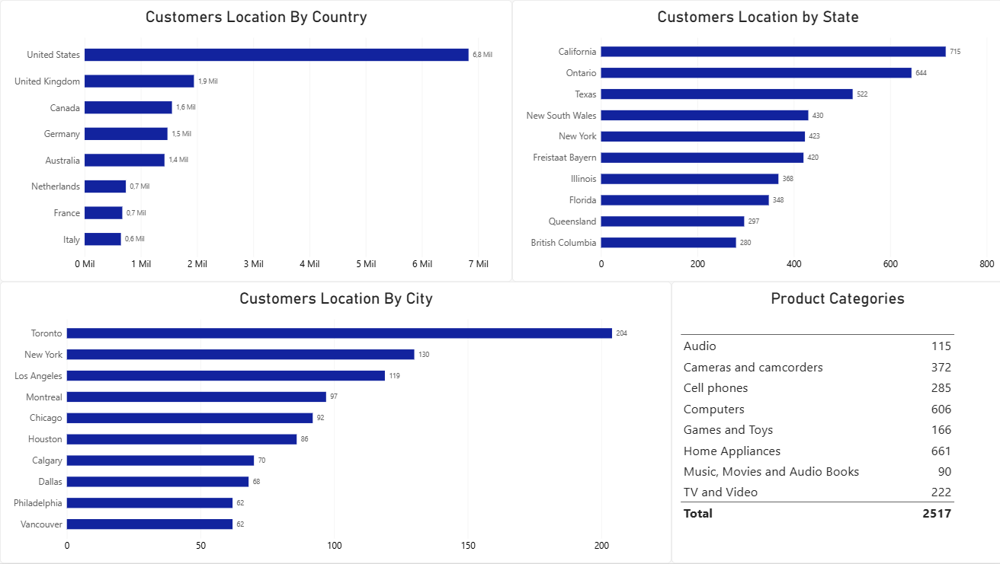
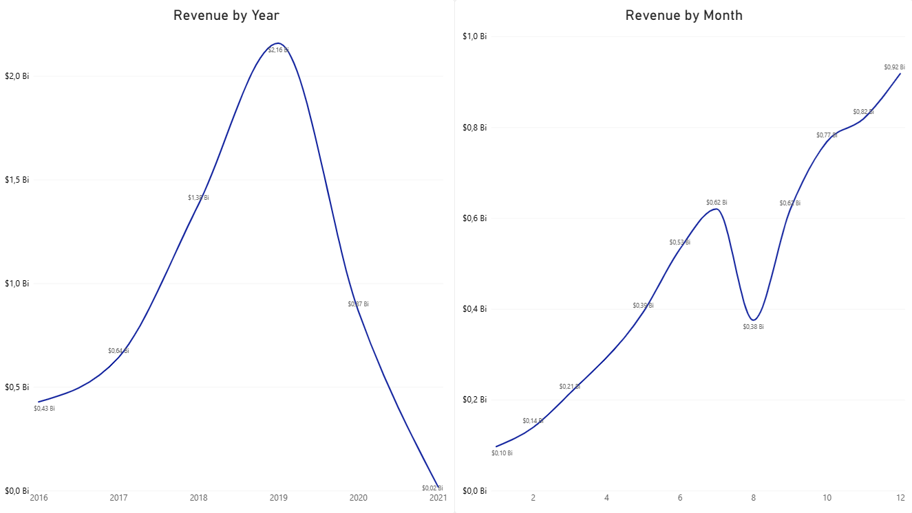
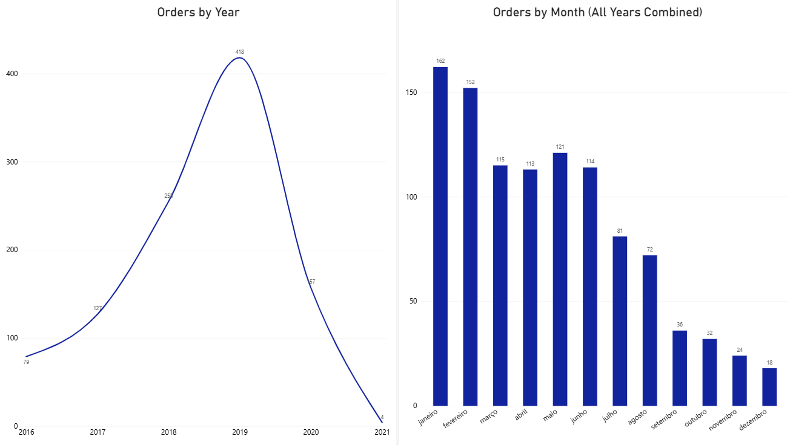
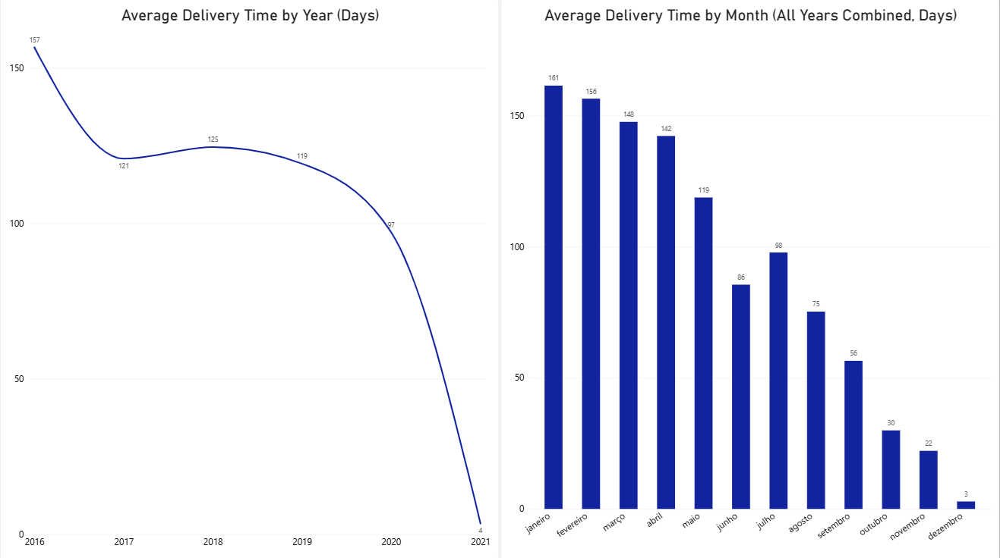

# Global Electronics Retailer | Power BI

## Project Overview

This project presents an analysis of a global electronics retailer using Power BI. It explores customer distribution across different countries, states, and cities, product categories, revenue trends, order patterns, and delivery performance.

The analysis covers data from 2016 to 2021, providing an overview of the company's operations and highlighting relevant business patterns and data limitations.

## Objectives

- Analyze customer distribution across countries, states, and cities.
- Explore the distribution of products across different categories.
- Evaluate annual and monthly revenue trends.
- Examine order volume across different years and months.
- Analyze average delivery times and identify relevant patterns.
- Highlight data limitations that may affect the interpretation of results.

## Tools & Technologies

- **Power BI Desktop** – Data visualization and dashboard development.
- **Power Query** – Data preparation and transformation.
- **DAX** – Calculated measures and analytical calculations.

## Data Sources

The project uses a dataset containing information about customers, products, sales transactions, orders, and delivery dates.

The available records cover the period from 2016 to 2021.

## Project Structure

The project is organized into four analytical dashboards and two conclusion pages:

1. **Products and Customers** – Customer distribution by country, state, and city, alongside product category distribution.
2. **Revenue Trends** – Annual and monthly revenue analysis.
3. **Order Trends** – Annual and monthly order volume analysis.
4. **Delivery Performance** – Average delivery time by year and month.
5. **Conclusion** – Final analysis and findings in English.
6. **Conclusão - Português** – Portuguese version of the final analysis.

## Data Preparation & Modeling

Data preparation and analytical calculations were performed in Power BI, using Power Query and DAX.

The process supported the analysis of customer distribution, product categories, revenue, order volume, and delivery intervals.

Special attention was given to data limitations, including incomplete periods, missing delivery dates, and unusually long delivery intervals, to avoid unsupported conclusions.

## Key Findings

### Customer & Product Distribution
- The United States has the largest customer base among the countries represented in the dataset.
- The United Kingdom, Canada, Germany, and Australia follow in customer distribution.
- Home Appliances and Computers are the largest product categories by item count.

### Revenue Trends
- Annual revenue increased significantly between 2016 and 2019, reaching approximately **US$2.16 billion** in 2019.
- Revenue declined to approximately **US$870 million in 2020** and **US$20 million in 2021**.
- Monthly revenue also presents considerable variation throughout the year.

### Order Trends
- Distinct orders increased from **79 in 2016** to **418 in 2019**.
- Order volume subsequently declined to **167 in 2020** and **4 in 2021**.
- January recorded the highest aggregated monthly order count, with **162 orders**, while December recorded the lowest, with **18 orders**.

### Delivery Performance
- The calculated average delivery time decreased from **157 days in 2016** to **97 days in 2020**.
- The average for 2021 was **4 days**, requiring cautious interpretation due to the limited number of records.
- Some calculated delivery intervals reached **330 days**, highlighting potential data quality issues.

## Dashboard Pages

### 1. Products and Customers

### 2. Revenue Trends

### 3. Order Trends

### 4. Delivery Performance

## Project Conclusion

The analysis provides an overview of the retailer's customer distribution, product categories, revenue trends, order volume, and delivery performance between 2016 and 2021.

Although the dashboards reveal relevant patterns across these areas, some findings require cautious interpretation due to limitations in the available data.

The sharp decline in revenue and order volume in 2021 may be related to an incomplete reporting period. Additionally, unusually long delivery intervals and missing delivery dates prevent the results from being treated as a reliable measure of logistical efficiency.

The dataset also lacks a reliable field to distinguish online sales from in-store transactions, making a comparison of average order value by sales channel unavailable.

For a more detailed discussion of the findings and limitations, see:

- [Global Electronics Retailer - Conclusion (English)](Global-Electronics-Retailer-Conclusion.md#english)
- [Global Electronics Retailer - Conclusão (Português)](Global-Electronics-Retailer-Conclusao.md#português)
